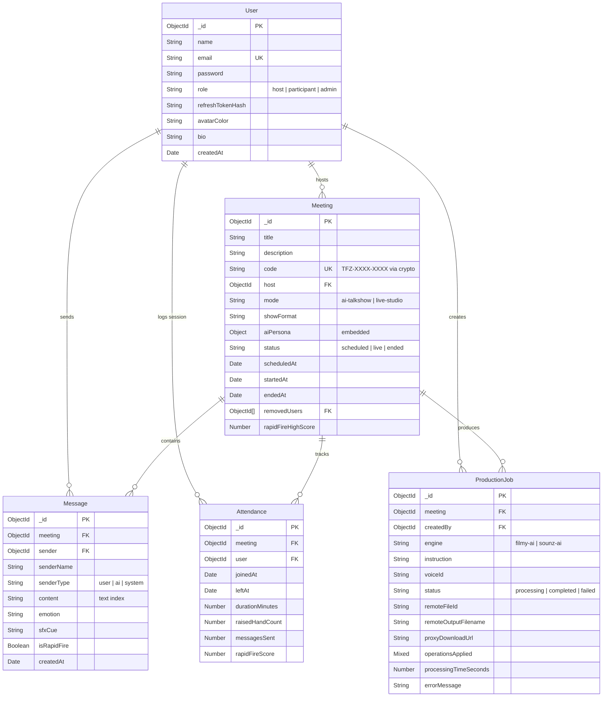

# TFounZ Database Schema & ER Diagram

## Entity-Relationship Diagram

---

## Indexes Configured

1. **`User`**: Unique index on `email` (`{ email: 1 }`).
2. **`Meeting`**:
   - Unique index `{ code: 1 }` for instant show join lookups.
   - Compound index `{ host: 1, createdAt: -1 }` for host dashboard history.
   - Compound index `{ status: 1, scheduledAt: 1 }` for live/scheduled filtering.
3. **`Message`**:
   - Compound index `{ meeting: 1, createdAt: 1 }` for chronological chat loading.
   - Full-text index `{ content: 'text' }` for searching show transcripts (`GET /api/meetings/:id/messages?q=...`).
4. **`Attendance`**:
   - Compound index `{ meeting: 1, user: 1, joinedAt: -1 }` for fast attendance aggregation and open-session resolution.
5. **`ProductionJob`**:
   - `{ meeting: 1, createdAt: -1 }` and `{ createdBy: 1, createdAt: -1 }`.

---

## MongoDB Aggregation Pipelines (Viva Reference)

### 1. MeetLite Attendance Report (`GET /api/meetings/:id/attendance-report`)
- **`$match`**: Filters `Attendance` documents for the target `meeting`.
- **`$addFields`**: Substitutes `$$NOW` when `leftAt` is null (live participant) and calculates `computedMinutes` using `$divide` on `$subtract`.
- **`$group`**: Aggregates per `user`: `firstJoinTime ($min)`, `lastLeaveTime ($max)`, `totalMinutes ($sum)`, `sessionsCount ($sum)`, `raisedHandCount ($sum)`, `messagesSent ($sum)`, `rapidFireScore ($max)`.
- **`$lookup` + `$unwind` + `$project` + `$sort`**: Joins user profile (`name`, `email`, `role`), rounds `totalMinutes` to 2 decimals, and sorts descending by `totalMinutes`.

### 2. Show History Enrichment (`GET /api/meetings/history`)
- **`$match`**: Finds shows hosted by or attended by the current user.
- **`$lookup`**: Joins `users` (host details), `attendances`, `messages`, and `productionjobs`.
- **`$project`**: Computes `uniqueParticipantCount` (`$size` + `$setUnion`), `messageCount`, and `productionJobCount` directly inside MongoDB.

### 3. Admin Platform Analytics (`GET /api/admin/stats`)
- Runs parallel aggregations across `User` (counts by role), `Meeting` (counts & live shows by `showFormat`), `ProductionJob` (counts by engine + status), and `Attendance` (total sessions, studio watch minutes, hands raised).
